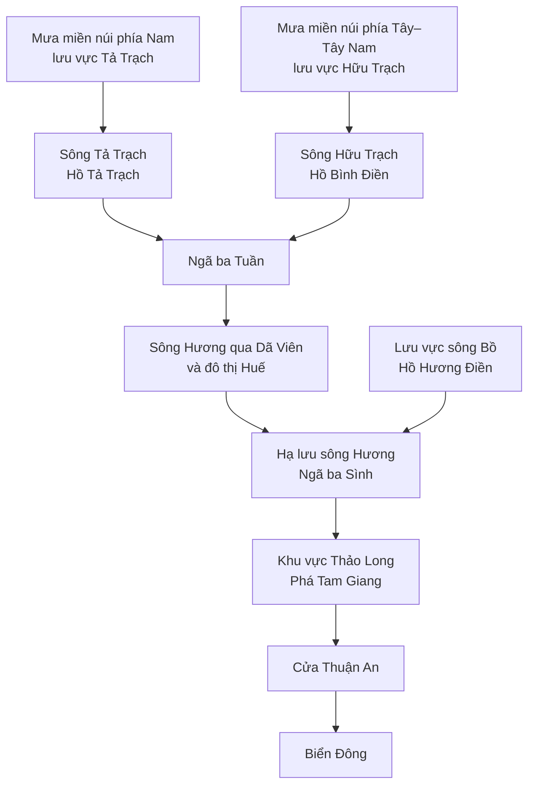

Tôi đã tìm và đối chiếu tài liệu địa hình của Huế, báo cáo JICA, nghiên cứu mô hình lũ sông Hương, nghiên cứu đầm phá–cửa biển và các bài báo giải thích mưa lớn.

**Kết luận quan trọng nhất cho dự án của mình: Huế nhìn chung thấp dần từ Tây sang Đông, nhưng muốn biết mưa ở đâu làm nước Dã Viên tăng thì phải xét lưu vực và đường nối sông, hồ chứa, đầm phá. Chia trạm thành Đông–Tây–Nam–Bắc mới là bước mô tả không gian.**

Một phát hiện đặc biệt đáng chú ý là **khu vực Hồng Thái–Nhâm của Model B nằm gần hệ thống A Sáp có hướng thoát nước tự nhiên sang Lào**, trong khi thủy điện A Lưới lại có tuyến chuyển nước sang sông Bồ. Vì vậy, correlation cao ở hai trạm này cần được giải thích thận trọng.

Dưới đây là bức tranh tổng hợp. “Huế” ở đây chỉ toàn vùng địa lý, gồm miền núi, đô thị và ven biển; tên địa phương trong một số tài liệu là tên cũ.

**Địa hình Huế tạo thành chuỗi núi cao → đồi thấp → đồng bằng → đầm phá → biển.**

Tài liệu chính thức của UBND thành phố mô tả địa hình thấp dần từ Tây sang Đông: phía Tây là núi cao, giữa là đồi núi thấp, phía Đông là đồng bằng nhỏ hẹp. Những dạng địa hình này nằm gần nhau trong một dải đất hẹp. [Tài liệu địa lý của UBND thành phố Huế](https://hue.gov.vn/Portals/0/Uploads/VBPL/Nam2026/Thang2/00.00.H57-521-QD-UBND-2026-PL5_signed.pdf)

Có thể hình dung:

| Khu vực | Đặc điểm địa hình | Ý nghĩa đối với nước mưa |
|---|---|---|
| Tây, Tây Nam và miền núi phía Nam | Núi cao, sườn dốc, nhiều thung lũng | Nước tập trung vào khe suối và sông; đường phân thủy quyết định nước đi về lưu vực nào |
| Vùng chuyển tiếp | Đồi thấp, chân núi, hồ chứa | Dòng chảy được tập trung và điều tiết trước khi xuống đồng bằng |
| Đồng bằng quanh đô thị Huế | Thấp, tương đối bằng phẳng, nhiều sông nhánh | Nước có thể tràn đồng, tích lại và chịu ảnh hưởng mực nước hạ lưu |
| Ven biển | Đầm phá phía trong dải cát chắn | Nước phải qua hệ thống đầm phá và các cửa biển để thoát |

Nghiên cứu lưu vực sông Hương năm 2017 mô tả vùng đồng bằng nghiên cứu có cao độ khoảng **1,5–8 m**, còn các tiểu lưu vực miền núi có địa hình rất dốc. Những con số này thuộc phạm vi nghiên cứu đó, không có nghĩa mọi điểm trong thành phố đều nằm trong khoảng cao độ trên. [Nghiên cứu mô hình thủy văn–thủy lực sông Hương](https://www.mdpi.com/2073-4441/9/11/879)

**Đường nước quan trọng nhất đối với Dã Viên là Tả Trạch và Hữu Trạch hợp lại, rồi chảy qua đô thị Huế.**

Theo báo cáo JICA, Tả Trạch bắt nguồn từ sườn Bắc dãy Bạch Mã, chảy về phía Bắc; sau khi nhập Hữu Trạch ở phía thượng lưu đô thị thì trở thành sông Hương. Sông Hương đi qua Huế, rồi mới nhận sông Bồ ở phía hạ lưu trước khi đổ ra phá Tam Giang. [Báo cáo khảo sát lưu vực của JICA](https://openjicareport.jica.go.jp/pdf/11740677_02.pdf)

Sơ đồ dưới đây biểu diễn đường nối chính, lược bỏ các nhánh nhỏ và dòng tràn đồng:

Với bài toán của mình, thứ tự này có ý nghĩa lớn:

- **Mưa trong lưu vực Tả Trạch và Hữu Trạch** có đường đóng góp dòng chảy từ thượng lưu tới đoạn sông qua Dã Viên.
- **Sông Bồ nhập sông Hương ở phía dưới đô thị.** Vì vậy, không nên coi toàn bộ mưa lưu vực Bồ là lượng nước trực tiếp chạy qua Dã Viên theo chiều xuôi sông. Khả năng tác động qua mực nước hạ lưu và nước dềnh là một cơ chế cần kiểm tra bằng dữ liệu thủy lực.

Điểm thứ hai là suy luận từ mạng sông và vị trí tương đối; chưa phải định lượng mức ảnh hưởng của sông Bồ tại đúng cảm biến Dã Viên.

**Không phải mọi trận mưa trong địa giới Huế đều chảy qua sông Hương ở Dã Viên.**

Huế có nhiều lưu vực cùng đổ ra vùng ven biển, nhưng không cùng đi qua một điểm đo. Luận án của Nghiem Tien Lam tại TU Delft mô tả hệ thống đầm phá nhận nước từ sông Hương, Ô Lâu, Đại Giang, sông Nông, Truồi và các nhánh khác. [Luận án về thủy động lực hệ thống cửa biển Huế, 2009](https://repository.tudelft.nl/file/File_c4c070d0-e452-49f1-bfbb-1d267865aebf)

| Hệ thống | Đường thoát nước khái quát | Cách hiểu khi dự báo Dã Viên |
|---|---|---|
| Tả Trạch | Miền núi phía Nam → Tuần → sông Hương | Nguồn thượng lưu cần ưu tiên |
| Hữu Trạch | Miền núi phía Tây → Tuần → sông Hương | Nguồn thượng lưu cần ưu tiên |
| Sông Bồ | Miền núi phía Tây–Tây Bắc → hạ lưu Bồ → nhập Hương phía dưới đô thị | Xét riêng dòng chảy và ảnh hưởng hạ lưu |
| Ô Lâu | Vùng phía Bắc → phía Bắc phá Tam Giang | Không mặc định nước phải đi qua Dã Viên |
| Truồi và các lưu vực phía Nam đầm phá | Xuống vùng Cầu Hai và hệ thống ven biển | Có thể cùng một đợt mưa nhưng khác đường thoát |
| A Sáp | Một phần miền núi A Lưới → sang Lào theo đường tự nhiên | Cần xét thêm công trình chuyển nước |

Cổng thông tin Huế cũng xác định phía Bắc phá Tam Giang bắt đầu từ vùng cửa sông Ô Lâu. Điều này cho thấy “cùng đổ ra đầm phá Huế” không đồng nghĩa “cùng chảy qua trung tâm Huế”. [Địa hình đầm phá và biển ven bờ Huế](https://hue.gov.vn/Du-khach/Thong-tin-du-khach/Kham-pha-Hue/tb/Dia-hinh-khu-vuc-dam-pha-va-bien-ven-bo-326960)

**Hồng Thái và Nhâm cần được nhìn trong bối cảnh đường phân thủy và chuyển nước A Sáp–sông Bồ.**

Đây là phần liên quan trực tiếp nhất đến Model B.

Báo cáo quy hoạch A Lưới mô tả:

- Hữu Trạch và sông Bồ chảy về hệ thống sông Hương rồi ra biển.
- A Sáp chảy dọc thung lũng A So–A Lưới, chuyển hướng về phía Tây, qua Hồng Thái, Quảng Nhâm rồi sang Lào.

Như vậy, ngay trong khu vực miền núi phía Tây Huế đã tồn tại các hướng thoát nước khác nhau. [Báo cáo quy hoạch A Lưới năm 2024](https://hue.gov.vn/Portals/0/Attachs/Nam2024/T8/00.30.H57-1178-UBND_-_TNMT-2024-PL2.pdf)

Tuy nhiên, EVN mô tả thủy điện A Lưới là công trình **chuyển nước từ A Sáp, thuộc thượng nguồn Sê Kông, sang sông Bồ**. Đây là sự kết nối do công trình tạo ra, bổ sung vào mạng thoát nước tự nhiên. [Tài liệu EVN về công trình thủy điện A Lưới](https://www.evn.com.vn/UserFile/User/tcdl/phan%203.pdf)

Vì vậy, correlation của hai trạm Model B có thể chứa nhiều cơ chế:

1. Mưa ở hai trạm đại diện tốt cho một đợt mưa rộng trên miền núi, bao gồm cả vùng thực sự sinh dòng chảy về sông Hương.
2. Có quan hệ với vận hành và chuyển nước trong hệ thống hồ–sông.
3. Hai chuỗi cùng phản ánh mùa mưa và các sự kiện thời tiết lớn.

**Đây là các giả thuyết cần kiểm chứng. Chưa thể kết luận nước rơi tại đúng vị trí hai cảm biến chảy về Dã Viên theo một tuyến cụ thể.** Muốn xác nhận phải đặt tọa độ trạm lên ranh tiểu lưu vực và kiểm tra mạng thoát nước, công trình.

**Bạch Mã quan trọng vì vừa ảnh hưởng mưa, vừa chứa các sườn núi thoát nước về những lưu vực khác nhau.**

Không khí ẩm gặp núi bị nâng lên, lạnh đi và ngưng tụ, làm tăng mưa ở các sườn đón gió. Nghiên cứu về trận mưa lớn miền Trung tháng 11/1999 xác định tương tác giữa địa hình, gió mùa Đông Bắc và hoàn lưu thời tiết là cơ chế tăng cường mưa. Thí nghiệm mô hình có và không có địa hình cho thấy vai trò đáng kể của địa hình trong sự kiện đó. [Nghiên cứu trên Tạp chí Khoa học và Công nghệ biển](https://vjs.ac.vn/jmst/article/download/12989/383682/397505)

Bài giải thích của VnExpress về đợt mưa tháng 10/2025 cũng dẫn chuyên gia khí tượng, mô tả việc nhiều hình thế thời tiết kết hợp với sườn núi Bạch Mã tạo mưa kéo dài. Đây là ví dụ của một sự kiện cụ thể, không phải mọi trận mưa ở Huế đều có cùng cơ chế. [VnExpress: vai trò địa hình Bạch Mã trong mưa lớn](https://e.vnexpress.net/news/news/environment/how-hue-mountain-acts-as-rain-funnel-to-become-one-of-world-s-wettest-places-4957825.html)

Điều này dẫn tới một cách đọc lại notebook:

**Một trạm Bạch Mã được xếp “Đông” so với Dã Viên vẫn có thể là trạm miền núi.** Nhãn Đông trong notebook chỉ là góc nhìn từ Dã Viên; chưa cho biết cảm biến nằm trên sườn thoát về Tả Trạch, Truồi hay lưu vực khác.

**Nước về nhanh ở miền núi nhưng có thể thoát chậm ở đồng bằng.**

Nghiên cứu Tả Trạch năm 2025 mô tả địa hình lưu vực hồ có độ dốc lớn, thời gian tập trung dòng chảy ngắn và dòng vào hồ biến động mạnh. Đồng thời, vận hành hồ Tả Trạch ảnh hưởng trực tiếp đến mực nước sông ở đô thị phía dưới. [Nghiên cứu dự báo dòng vào hồ Tả Trạch](https://link.springer.com/article/10.1007/s13201-025-02503-4)

Có thể tách quá trình một trận mưa thành:

- Nước thấm xuống đất, bị giữ lại hoặc chảy trên mặt.
- Nước tập trung từ sườn núi vào khe suối.
- Dòng chảy tới hồ và sông chính.
- Hồ giữ lại hoặc đưa nước xuống hạ du theo trạng thái vận hành.
- Nước đi qua đồng bằng, tràn vào vùng thấp và thoát về đầm phá.

**Độ trễ mưa–mực nước vì thế không phải một hằng số.** Nó thay đổi theo vị trí mưa, đất đã ướt đến đâu, trạng thái hồ, mức nước sông và điều kiện thoát phía dưới. Không có cơ sở để gán chung “mưa miền núi mất đúng 12 giờ về Dã Viên”.

Đây cũng là lý do **correlation cao tại horizon +12h không đồng nghĩa thời gian nước di chuyển là 12 giờ**. Biến mục tiêu của mình là thay đổi mực nước từ hiện tại đến tương lai, trong đó có thể chứa nhiều quá trình cùng lúc.

**Đầm phá và biển là điều kiện ở đầu ra của hệ thống.**

Tam Giang–Cầu Hai nằm phía trong dải cát ven biển và trao đổi với biển qua các cửa chính Thuận An, Tư Hiền. Nghiên cứu thủy động lực sử dụng mực nước triều ngoài hai cửa làm điều kiện biên phía hạ lưu; đồng thời cho thấy hình thái cửa biển thay đổi do dòng lũ và vận chuyển bùn cát. [Luận án TU Delft](https://repository.tudelft.nl/file/File_c4c070d0-e452-49f1-bfbb-1d267865aebf)

Ý nghĩa vật lý là: khi mực nước phía dưới cao, chênh lệch mực nước giúp thoát dòng từ phía trên có thể giảm. Vì vậy, cùng một lượng nước về chưa chắc tạo cùng diễn biến mực nước nếu điều kiện đầm phá–biển khác nhau.

Tuy nhiên, **mức ảnh hưởng của triều tại đúng trạm Dã Viên trong từng chế độ nước vẫn cần kiểm tra**. Không nên mặc định triều chi phối mọi đợt lũ, cũng không nên bỏ qua nó chỉ vì trạm nằm trong đô thị.

**Hồ chứa làm thay đổi quan hệ giữa mưa và nước hạ lưu.**

Ba công trình cần phân biệt là:

| Công trình | Nhánh sông |
|---|---|
| Tả Trạch | Tả Trạch |
| Bình Điền | Hữu Trạch |
| Hương Điền | Sông Bồ |

Thông tin của cơ quan phòng chống thiên tai xác nhận việc phối hợp các hồ này để hạ mực nước, tăng dung tích đón lũ trước những đợt mưa. [Thông tin vận hành hồ trong đợt mưa năm 2023](https://dmc.gov.vn/news-detail/warning-of-heavy-rain-in-the-huong-river-basin-causing-risk-of-flash-floods-landslides-and-inundation-cd11171-32.html?lang=en-US)

JICA cũng xây dựng hệ thống quản lý lũ kết hợp quan trắc mưa, mực nước, giám sát hồ và thông tin dự báo cho ba hồ. Điều này củng cố việc phải xem mưa và vận hành hồ cùng nhau khi nghiên cứu lũ sông Hương. [JICA, tổng hợp hợp tác phòng chống thiên tai năm 2025](https://www.jica.go.jp/overseas/vietnam/others/pamphlet/__icsFiles/afieldfile/2025/03/13/disaster_prevention_en.pdf)

Suy ra đối với mô hình: cùng một mức mưa quan trắc, hồ đang còn khả năng giữ nước và hồ đang đưa nhiều nước xuống hạ du có thể tạo hai đáp ứng khác nhau. Đây là một nguyên nhân tiềm năng khiến mô hình chỉ nhìn mưa–nước phản ứng trễ; **chưa phải chẩn đoán đã được chứng minh cho các lỗi của Model B**.

**Với bài toán Dã Viên +12/+24 giờ, tôi đề xuất diễn giải kết quả hiện tại như sau.**

| Điều đã thấy | Cách hiểu có cơ sở hơn |
|---|---|
| Hai trạm tốt của B đều ở phía Tây | Chúng là tín hiệu dự báo hữu ích; chưa chứng minh cả hai thuộc lưu vực trực tiếp phía trên Dã Viên |
| Trạm tốt nhất ở mỗi hướng khác nhau | Có thể phản ánh các vùng mưa khác nhau, nhưng chưa thể gọi là bốn nguồn nước đóng góp |
| Correlation toàn kỳ của một trạm thấp | Không loại trừ vai trò trong một số đợt mưa hoặc điều kiện hồ cụ thể |
| Sai số tập trung khi nước tăng/giảm | Cần kiểm tra vị trí tâm mưa, độ trễ, trạng thái lưu vực, hồ và điều kiện hạ lưu |
| Tăng số trạm chưa giúp model tốt hơn | Trạm mới có thể trùng thông tin hoặc khác lưu vực; số lượng trạm không thể thay cho cấu trúc thủy văn |

**Hướng nghiên cứu tiếp theo nên là chuyển từ “bốn hướng” sang “các nhóm thủy văn có đường nối rõ ràng”.** Cụ thể:

1. Đặt toàn bộ trạm lên bản đồ cao độ, mạng sông và ranh lưu vực; xác định từng trạm thuộc Tả Trạch, Hữu Trạch, Bồ, Ô Lâu, vùng đầm phá hay ngoài lưu vực.
2. Tách các trạm nằm phía trên và phía dưới hồ chứa; ghi nhận riêng tuyến chuyển nước A Sáp–Bồ.
3. Phân tích mưa theo từng lưu vực, nhiều độ trễ và riêng từng sự kiện tăng/giảm nước ở +12/+24h.
4. Với những lỗi >200 mm, kiểm tra xem tâm mưa nằm ngoài vùng đại diện của hai trạm B hay có biến đổi vận hành hồ, điều kiện hạ lưu.

Phần chưa thể khẳng định chỉ bằng đọc tài liệu là **ranh thoát nước tại đúng tọa độ từng cảm biến, thời gian truyền nước tới Dã Viên và mức đóng góp của mỗi vùng trong các sự kiện của dataset**. Những câu hỏi đó cần phân tích GIS và chuỗi quan trắc. Notebook bốn hướng hiện tại vẫn hữu ích để khám phá, nhưng bản đồ lưu vực sẽ là nền tảng chắc hơn để quyết định trạm nào nên đưa vào mô hình.