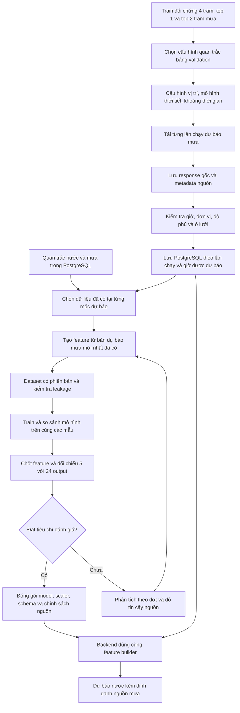

# Bổ sung dự báo mưa vào mô hình dự báo mực nước

**Architecture & Implementation Plan — v0.2**
**Ngày lập:** 18/10/2026
**Cập nhật:** 19/10/2026
**Trạng thái:** Đã thu thập/lưu archive, tạo dataset forecast mask/-1 và train các
model nghiên cứu có feature thời tiết. Chưa thay model production trong app.

**Thứ tự thí nghiệm đã thống nhất, cập nhật 18/10/2026:** chọn số trạm mưa đầu
vào trước → thử feature dự báo thời tiết → cuối cùng so sánh 5 và 24 output.
Tài liệu bao gồm các bước đối chứng này để không trộn tác động của nhiều thay đổi.
Sau khi có model B, ưu tiên ba việc ở mục 1.6: loss hướng/biên độ → fine-tune
tail penalty → kiểm tra và ablation lịch sử dự báo mưa. Thử 24 output vẫn ở cuối.

Tài liệu mở rộng [ARCHITECTURE.md](ARCHITECTURE.md), tập trung vào dự báo mưa
ECMWF qua Open-Meteo cho trạm Dã Viên trước, sau đó có thể cấu hình cho trạm khác.

Quy ước:

- **[ĐÃ THỐNG NHẤT]:** mục tiêu và ý nghĩa tín hiệu đã trao đổi với chủ dự án.
- **[ĐỀ XUẤT]:** thiết kế triển khai, được điều chỉnh khi có kết quả kiểm thử.
- **[CẦN XÁC MINH]:** điều kiện dữ liệu/chất lượng phải kiểm tra trước khi sử dụng.
- **[ĐÃ KHẢO SÁT]:** có artifact đối chiếu; không đồng nghĩa đã triển khai production.

## 1. Công việc này là gì?

**[ĐÃ THỐNG NHẤT]** Xây dựng pipeline thu thập, lưu lịch sử từng bản dự báo mưa,
tạo feature và train lại mô hình nước với thông tin có sẵn tại thời điểm dự báo.

Hiện mô hình dùng mưa đã quan trắc. Đầu vào mới bổ sung mưa có thể xảy ra trong
tương lai, giúp mô hình có cơ hội nhận biết sớm một đợt nước tăng. Không bắt buộc
phải xây dựng mô hình dự báo mưa riêng ngay từ đầu.

Lượng mưa dự báo mới nhất có thể là tín hiệu sớm về mưa lớn sắp xảy ra, dù
chưa khớp hoàn toàn với lượng mưa đo được sau đó. Mô hình phải học cách sử dụng
thông tin này từ dữ liệu; không viết quy tắc cứng “mưa tăng thì cộng thêm nước”.
Tín hiệu mưa lớn không tự xác nhận có bão hoặc lũ tại Dã Viên.

### 1.1. Hai hướng thực hiện

| Hướng | Đầu vào → đầu ra | Thứ tự |
|---|---|---|
| Bổ sung feature cho mô hình nước | Nước/mưa quá khứ + dự báo mưa → nước tương lai | Sau khi thử số trạm mưa |
| Hiệu chỉnh dự báo mưa riêng | Dự báo ECMWF + quan trắc quá khứ → mưa tương lai đã hiệu chỉnh | Chỉ thử sau khi đánh giá hướng đầu |

### 1.2. Phạm vi và thứ tự đã thống nhất

- Dã Viên; ở hai bước đầu giữ 5 horizon +1/+3/+6/+12/+24 giờ và lịch sử đầu vào 96 giờ.
- Giữ cách tổng hợp quan trắc hiện tại để so sánh có kiểm soát.
- **Bước 1:** thử 4 trạm mưa hiện tại so với 1 và 2 trạm có correlation cao nhất;
  chưa thêm feature thời tiết mới.
- **Bước 2:** cố định cấu hình trạm đã chọn, thử thêm lượng mưa dự báo mới nhất đã có tại thời điểm dự báo nước.
- **Trước bước 3:** thực hiện ba thử nghiệm cải thiện model B theo mục 1.6,
  bắt đầu bằng custom loss hướng/biên độ; chưa đổi số output đồng thời.
- **Bước 3, cuối cùng:** cố định nguồn/feature, thử 24 output cho +1 đến +24 giờ
  so với 5 output hiện tại.
- Tách thử nghiệm feature khỏi thay đổi số output, loss, correction penalty,
  kiến trúc lớn hoặc thay đồng loạt các nguồn mưa.
- Đánh giá cả pha nước lên, nước rút, mưa ít và các đợt mưa lớn.

### 1.3. Bước 1 — ablation số trạm mưa quan trắc

**[ĐÃ THỐNG NHẤT]** Bốn nguồn đang nói tới là bốn **trạm mưa** đầu vào của mô
hình nước Dã Viên, không phải bốn trạm nước cần dự báo. Cần kiểm tra liệu các
trạm gần nhau có thông tin dư thừa và một/hai trạm đã đủ hiệu quả hay chưa.

| Nhóm | Nguồn mưa | Feature thời tiết mới | Output |
|---|---|---|---|
| S4 | Cả bốn trạm hiện tại | Không | 5 |
| S1 | Một trạm đứng đầu theo train | Không | 5 |
| S2 | Hai trạm đứng đầu theo train | Không | 5 |

Các việc phải làm:

1. Chốt snapshot, split, target, quy tắc tổng hợp và các anchor có thể chấm chung.
2. Tính lại correlation **chỉ trên train** cho bốn trạm; lưu số cặp hợp lệ, độ
   phủ, cách tính, lag và cửa sổ mưa. Không tái sử dụng thứ hạng đã tính trên toàn
   lịch sử như thể đó là thứ hạng không leakage.
3. Đánh giá mưa quá khứ với nước hoặc thay đổi nước tương lai theo horizon;
   mọi feature mưa phải kết thúc tại anchor. Kiểm tra cả tương quan giữa các trạm
   để mô tả dư thừa. Chọn trước quy tắc gộp điểm để có một thứ hạng; không chọn
   lag/thứ hạng riêng theo test hoặc theo đợt lỗi đang quan tâm.
4. Tạo schema S1/S2/S4 từ cùng nguồn; mỗi trạm giữ cùng bộ mưa hiện tại và mask.
   Bỏ toàn bộ feature/mask của trạm bị loại, không chỉ che giá trị bằng 0. Giữ
   feature nước và mùa như nhau; fit scaler riêng trên cùng train của từng nhóm.
5. Train mới cả ba nhóm, cùng seed, cấu hình LSTM/loss/penalty và ngân sách.
   Input size tự đổi theo schema; không ép còn 29 hoặc dùng checkpoint cũ để
   đại diện cho S4 train trên dataset/split mới.
6. Chọn cấu hình bằng validation và độ ổn định qua seed/đợt; báo cáo test chung
   sau khi chọn. Correlation cao là cách đề xuất nguồn, không phải bằng chứng
   một/hai trạm đủ cho dự báo hoặc bốn trạm là tối ưu.
7. So sánh MAE/RMSE/bias theo horizon, lỗi >200 mm, chuỗi thiếu/thừa, pha tăng/
   giảm và thời gian train/inference. Báo cả độ phủ; bỏ trạm có thể thay đổi số
   mẫu nhưng không được làm tập so sánh dễ hơn một cách âm thầm.

**Đầu ra:** bảng ranking và tương quan giữa trạm; manifest S1/S2/S4; bảng metric
trên cùng anchor; figure theo đợt; kết luận cấu hình quan trắc dùng làm đối chứng
ở bước 2. Nếu kết quả gần tương đương, báo mức chênh lệch và độ biến động, ưu
tiên cấu hình đơn giản khi đáp ứng tiêu chí đã chốt; không tuyên bố tối ưu tuyệt đối.

**[ĐỀ XUẤT]** Khởi đầu với top-1/top-2 thay vì quét mọi tập con. Nếu muốn thử
cặp trạm bổ sung thông tin thay vì top-2 correlation, đó là nhánh bổ sung chọn
trên train/val, có tên riêng. Chưa thay nguồn phía nam hoặc tăng số trạm trong
thí nghiệm đầu tiên.

#### Kết quả khảo sát correlation ngày 18/10/2026

Dataset đang dùng có tên `train_data/da_vien_1h_2026-10-15`; tên dài trước đây
được giữ làm symlink local để các MLflow run/lệnh cũ vẫn đọc được cùng dữ liệu.
Đổi tên không cập nhật snapshot sau 15/10 và không thay đổi CSV, split hoặc
manifest gốc. `dataset_identity.json` lưu tên cũ và checksum trước khi đổi tên.

Đã tính Pearson giữa mưa 6 giờ quá khứ và thay đổi nước 12 giờ tiếp theo;
trên cùng các mốc hợp lệ của cả bốn trạm: 6.161 cặp ở train, 7.988 cặp toàn bộ.

| Trạm | r train | Hạng train | r toàn bộ | Hạng toàn bộ |
|---|---:|---:|---:|---:|
| Nhâm | 0,405102 | 1 | 0,277667 | 2 |
| Hồng Thái | 0,394088 | 2 | 0,297903 | 1 |
| Thị trấn A Lưới | 0,374857 | 3 | 0,265868 | 3 |
| Hồ A Lá | 0,370765 | 4 | 0,260278 | 4 |

Đề xuất ablation theo train: S1 = Nhâm; S2 = Nhâm + Hồng Thái; S4 = cả bốn.
Toàn bộ dữ liệu làm đổi thứ hạng hai trạm đầu nhưng không đổi cặp top 2.
Đây là cơ sở đề xuất thí nghiệm, chưa phải bằng chứng dùng một/hai trạm đủ.
Cặp mưa 6h/nước 12h được kế thừa từ khảo sát toàn thời gian trước đây, nên
chưa thể coi toàn bộ quá trình chọn tiêu chí là hoàn toàn độc lập với test.

Script: `research/rank_rain_stations.py`. Có bảng đầy đủ 25 cặp cửa sổ/horizon,
correlation riêng từng trạm theo độ phủ và ma trận tương quan giữa các trạm.
[Báo cáo local](../reports/rain_station_correlation_2026-10-18/phan_tich.md).
RS-01 đã có kết quả khảo sát này. Code chọn/loại feature từng trạm đã có qua
`--num-rain-station 1–4`, tự xếp hạng correlation chỉ trên train và lấy top N;
mỗi nhóm checkpoint được lưu riêng. Xem
[lệnh train S1/S2/S4](../research/RAIN_STATION_ABLATION.md).
**Cập nhật 19/10:** đã chạy các ablation số trạm; cấu hình bước 1 được chọn là
hai trạm, correction penalty 0.1, horizon weights `1 1 1.5 1.5 2`. Bản lưu đúng
model có trong báo cáo run `83e9c3fa81ea432d9d960965e72d18e1`. Kết quả strict
test: 55 lỗi >200 mm, RMSE gộp 78.28 mm. Phân tích toàn bộ có tại
[báo cáo bước 1](../reports/step1_full_dataset_20261019/REPORT.md).

### 1.4. Bước 2 — bổ sung feature dự báo thời tiết

**[ĐÃ THỐNG NHẤT]** Sau khi chốt cấu hình trạm mưa từ bước 1, thử bổ sung
lượng mưa dự báo mới nhất từ ECMWF đã có tại thời điểm dự báo nước. Giữ nguyên 5 output
để tách hiệu quả nguồn thông tin mới khỏi thay đổi số horizon.

Các việc phải làm:

1. **Giữ số trạm đã chọn ở bước 1.** Ví dụ bước 1 cho thấy dùng hai trạm tốt
   nhất thì các model ở bước 2 đều dùng đúng hai trạm đó. Train một model chỉ
   nhận nước và mưa quá khứ để làm mốc so sánh.
2. **Tải dự báo mưa lịch sử từ ECMWF.** Với từng ngày trong dataset, lấy các
   bản dự báo mưa cho khu vực liên quan. Kiểm tra ngày nào có/thiếu dữ liệu,
   bản dự báo được công bố lúc nào và áp dụng cho vị trí nào. Lưu cả dữ liệu
   lẫn thông tin nguồn để sau này biết chính xác model đã dùng bản nào.
3. **Thêm lượng mưa dự kiến trong các giờ tới vào dataset.** Ví dụ dự báo
   nước lúc 06:00 ngày 12/09: thêm lượng mưa ECMWF dự kiến từ 06:00 đến
   09:00, 12:00, 18:00 và 06:00 hôm sau, tương ứng 3/6/12/24 giờ tới.
   Chỉ dùng bản đã công bố trước hoặc đúng 06:00; không lấy mưa đo được sau
   06:00 rồi đưa vào như thể model đã biết trước.
4. **Train hai phiên bản để biết dự báo mưa có giúp ích không.** Phiên bản
   thứ nhất chỉ dùng nước/mưa quá khứ; phiên bản thứ hai thêm lượng mưa dự báo
   mới nhất đã có. Giữ cùng các khoảng train/val/test, cùng cách train, loss,
   penalty và 5 output. Chỉ thay đầu vào cần thử.
5. **Cho hai model dự báo đúng cùng các thời điểm rồi so sai số.** Kiểm tra
   từng mốc +1/+3/+6/+12/+24 giờ, lúc nước lên/rút và các đợt mưa lớn. Đếm
   cả lỗi >200 mm và các chuỗi lỗi kéo dài. Ghi rõ khi nguồn thời tiết bị thiếu
   và cách xử lý. Dùng tập validation để chọn phiên bản; tập test để đánh giá
   sau khi chọn, không liên tục sửa model để khớp các ví dụ test đã xem.
6. **Chọn phiên bản hiệu quả nhất để sang bước 3.** Nếu thêm dự báo mưa giúp
   ích thì giữ; nếu chưa giúp thì giữ model chỉ dùng quan trắc. Sau đó mới
   thử tăng từ 5 lên 24 output.

Tên dùng ở các mục kỹ thuật bên dưới: **A** là phiên bản chỉ có quan trắc,
**B** thêm lượng mưa dự báo mới nhất đã có tại thời điểm dự báo nước.
`Mask` là cờ đánh dấu thiếu dữ liệu; `anchor` là thời điểm đầu vào cuối cùng
của một lần dự báo nước.

**Đầu ra:** dữ liệu dự báo mưa đã lưu và kiểm tra; hai bộ đầu vào A/B;
hai phiên bản model; bảng sai số và biểu đồ; kết luận nên giữ đầu vào nào.
Các task tương ứng là FR-01 đến FR-09. Mô hình hiệu chỉnh mưa riêng là nhánh
tùy chọn ở mục 10, không phải điều kiện để hoàn thành bước 2.

### 1.5. Bước 3 — thử 24 output sau các thí nghiệm nguồn đầu vào

**[ĐÃ THỐNG NHẤT]** Cuối cùng thử dự báo trực tiếp **+1,+2,…,+24 giờ**, mỗi
output là mực nước trung bình giờ tại horizon tương ứng. Không nội suy 5 output
để tạo 24 nhãn. Dataset cần lấy thực tế cho từng giờ tương lai.

Các việc phải làm:

1. Chốt cấu hình nguồn/feature sau bước 2; nếu thời tiết không cải thiện thì giữ
   cấu hình chỉ quan trắc. Đóng băng cấu hình này ở cả hai nhóm O5 và O24.
2. Tạo dataset 24 target từ cùng snapshot; giữ nhãn thiếu, lưới giờ và provenance.
   Kiểm tra số mẫu hợp lệ cho đủ 24 target; 24 output có thể mất thêm anchor có
   giờ trung gian thiếu. So sánh O5/O24 trên cùng anchor và báo riêng độ phủ đầy đủ.
3. Giữ purge ít nhất 24 giờ vì horizon dài nhất không đổi; fit target scalers
   trên train, có thứ tự cột +1 đến +24 rõ ràng. Đổi output head, không giữ
   checkpoint/scaler 5 output cho model 24 output.
4. Cập nhật builder target, loader, CLI và trọng số loss để không cố định năm
   cột/horizon; chạy kiểm tra save/load và inverse transform đủ 24 giá trị.
5. Train O5/O24 với cùng backbone, input, seed, lịch tối ưu và quy tắc chọn
   checkpoint. Log số tham số mới do output head và số mẫu thực sự dùng.
6. Chốt trước cách phân bổ trọng số loss theo giờ. Khi dùng loss không đồng
   nhất, giữ tỷ lệ trọng số trên năm horizon chung và thử kiểm soát tổng trọng
   số dành cho chúng; log trọng số chuẩn hóa thực tế. Không mặc định thêm 19
   output sẽ làm +24 giờ được phạt nặng hơn: với MSE trung bình đều, tỷ trọng
   riêng của +24 giờ giảm từ 1/5 xuống 1/24. Mọi khác biệt phân bổ loss phải
   được ghi là một phần của thí nghiệm, không quy toàn bộ hiệu quả cho số output.
7. Đánh giá ngang hàng tại +1/+3/+6/+12/+24 giờ, đặc biệt +24; báo thêm đủ 24
   horizon, đường dự báo, đỉnh/pha nước, chuỗi lỗi và độ ổn định. Không so trực
   tiếp loss chuẩn hóa tổng của hai bài toán để kết luận model nào tốt hơn.
8. Chỉ khi O24 được chọn mới cập nhật cấu hình serving, metadata/API/frontend
   và test để biểu diễn đúng 24 mốc thật. Mỗi forecast ghi horizon list/schema;
   không làm kết quả cũ 5 mốc trông như kết quả mới 24 mốc.

**Đầu ra:** dataset/manifest O5 và O24; cấu hình trọng số; checkpoint/scaler
riêng; bảng so sánh năm horizon chung và bảng đủ 24 giờ; figure cùng anchor;
kết luận có cải thiện +24 giờ và có đáng đổi model serving hay không.

Thử 24 output không bảo đảm cải thiện +24 giờ. Mục tiêu là đo hiệu quả của
giám sát thêm các giờ trung gian, tách khỏi các thay đổi nguồn mưa trước đó.

#### O5/O24 — code và dataset đã chuẩn bị ngày 19/10

Đã tạo `train_data/da_vien_1h_2026-10-15_forecast_mask_o24` từ snapshot B:
26 feature giữ nguyên, 24 nhãn quan trắc giờ thật, các nhãn năm mốc cũ khớp
nguồn. Cả O5 và O24 có 6095/985/592 sequence; không mất thêm mẫu, giữ purge
24 giờ và NaN cuối snapshot. Builder kiểm tra hai quần thể nhãn đầy đủ khớp
nhau trước khi xuất; snapshot khác có lỗ nhãn gây lệch sẽ dừng rõ.

Entry point nghiên cứu riêng: `research.output_horizon_experiment --outputs
5|24`, train từ đầu, không nạp trọng số B. Scaler chỉ fit trên train. Các
thống kê scaler feature và năm target chung đã đối chiếu khớp B hiện tại.
Checkpoint mặc định dùng N200/hòa RMSE trên năm horizon chung cho cả hai nhóm.

Chốt loss lượt đầu: `B_loss(common5) + 0.25 * B_loss(extra19)`; correction
regularization cũng dùng cùng cách tách nhóm. Giữ nguyên hệ số riêng của năm
mốc cũ thay vì normalize đều toàn bộ 24 output. Đây là supervision phụ có
trọng số công bố, không mặc định +24 giờ sẽ được cải thiện. Lưu checkpoint
combined val_loss thấp nhất riêng, không so trực tiếp loss tổng O5 và O24.

Pipeline sau train tự ghi đủ metric 24 horizon và so năm mốc chung với B
(hoặc checkpoint O5 được chỉ định) và production trên cùng test anchor. Có
RMSE, >200/>400 mm, fixed/new, chuỗi lỗi, ghép đỉnh/đáy và figure. Model/scaler/
history/settings nằm trong thư mục mới, không đổi backend/frontend/registry.

**Chưa chạy training O5/O24.** Chỉ build dataset, chạy test và check-only
forward/backward không optimizer step. Chủ dự án sẽ tự train và xét kết quả.
[Hướng dẫn và command đầy đủ](../research/OUTPUT_HORIZON_ABLATION.md).

### 1.6. Ba việc tiếp theo sau model B — cập nhật 19/10/2026

**[ĐÃ THỐNG NHẤT]** Ưu tiên hiện tại là giảm lỗi lớn còn lại của B, đặc biệt
dự báo tăng chưa đủ và dự báo giảm chưa kịp. Thứ tự thực hiện:

1. **BL-01 — custom loss hướng thay đổi, biên độ và lỗi >200 mm. Làm đầu tiên.**
2. **BL-02 — fine-tune B với tail penalty mạnh hơn**, làm đối chứng riêng cho
   tác dụng tăng phạt sai số lớn, không trộn với thay đổi BL-01.
3. **BL-03 — kiểm tra và thử nghiệm cách đưa lịch sử dự báo mưa vào input**,
   phân biệt phần đã có với thông tin quá khứ thực sự mới.

BL-01 đã có lượt thử đầu tiên trên cả fine-tune và train từ đầu, BL-02 đã thử
fine-tune ba mức tail penalty, BL-03 đã train ablation forecast cả chuỗi so với
chỉ tại anchor (kết quả bên dưới). Sau khi chốt loss/input mới quay lại
O5/O24, không bỏ kế hoạch 24 output.

#### Mốc đối chứng và điều đã quan sát

Model B được train lại đúng cấu hình, lưu riêng tại
`model/experiments/model_b_retrain_20261019/`. Strict test: 48/2.960 dự báo lỗi
>200 mm (1,62%), RMSE gộp 75.78 mm. Dataset mask, 26 input, sequence 96, 5 output,
2 trạm mưa, correction penalty 0.1, horizon weights `1 1 1 1 1`, tail penalty
0.5, threshold 200 mm, transition 20 mm, chọn checkpoint `large_error_rate`.

Trên 39.550 dự báo toàn bộ dataset, production có 260 lỗi >200 mm, B có 209;
nhưng lỗi >400 mm tăng từ 14 lên 19. B còn 112 dự báo thiếu và 97 dự báo thừa;
197/209 lỗi thuộc chuỗi liên tiếp. Đây là động lực kiểm tra phản ứng tăng/giảm,
không phải bằng chứng đã đo được độ trễ cố định hoặc xác định nguyên nhân.
[Phân tích B](../reports/model_b_full_dataset_20261019_complete/REPORT.md).

#### BL-01: khuyến khích đúng hướng, phạt sai biên độ và phạt mạnh lỗi lớn

**Hành vi mong muốn:** dự báo đúng hướng tăng/giảm được thưởng có giới hạn,
nhưng đúng hướng chưa đủ. Nếu tăng/giảm quá yếu hoặc quá mạnh thì vẫn bị phạt;
phần phạt phải chiếm ưu thế khi sai số mực nước vượt 200 mm. Không khuyến khích
model luôn dự báo thay đổi mạnh hoặc luôn đi xa persistence.

Với từng horizon h, dùng đơn vị mm:

```text
delta_true = H(t+h) - H(t)
delta_pred = H_pred(t+h) - H(t)
error = H_pred(t+h) - H(t+h) = delta_pred - delta_true
```

Hướng đúng xét theo dấu của hai delta. Biên độ quá yếu/quá mạnh xét mức thay đổi
dự báo so với thay đổi thật, không chỉ so dấu. Khi nước gần như không đổi,
dùng vùng trung tính ±epsilon mm để tránh thưởng/phạt dấu của biến động rất nhỏ;
epsilon phải chốt trên train, không chọn từ các lỗi test đã xem.

**[ĐỀ XUẤT]** Giữ loss dự báo hiện tại và correction regularization, thêm các
thành phần có thể bật/tắt riêng:

```text
L = L_base + lambda_dir * (1 - R) + lambda_amp * L_amp
    + lambda_tail * L_excess + L_correction

R = R_direction * amplitude_gate,  0 <= R <= 1
amplitude_gate = exp(-(error / amplitude_scale_mm)^2)
z = max((abs(error) - 200 mm) / tail_scale_mm, 0)
L_excess = z^2 + gamma * z^4, gamma >= 0
```

- `R_direction` là hàm trơn, bị chặn, cao khi hướng đúng; không dùng phép so
  dấu rời rạc làm thành phần duy nhất để truyền gradient. Thưởng chỉ giảm một
  phần loss hữu hạn. Gate làm thưởng giảm khi sai biên độ lớn, nên không thể
  bù phần phạt cực lớn chỉ bằng việc đúng hướng. Công thức chính xác cần chốt
  và kiểm tra gradient khi triển khai; vùng trung tính tắt phần xét hướng.
- `L_amp` ưu tiên các mẫu biến động mạnh hoặc sai hình dạng giữa các horizon.
  Chỉ dùng MSE của `delta_pred - delta_true` thì bằng MSE mực nước hiện tại,
  không tạo mục tiêu mới. Nếu giữ dạng đó, phải ghi rõ đây chỉ là tăng trọng số
  MSE và kiểm chứng trong ablation, không mô tả là loss hướng mới.
- `L_excess` tăng rất nhanh theo mức vượt 200 mm; thử bình phương trước, rồi
  bậc bốn nếu cần. Không mặc định dùng exponential tăng không giới hạn. Hàm
  phạt liên tục tại ngưỡng, không dùng bước nhảy làm mất ổn định gradient.
  Ngưỡng 200 mm là sai số so thực tế, không phải độ thay đổi nước so đầu vào.
- Tính `error` theo mm từ target scaler đã lưu trước khi xét ngưỡng. Chuẩn hóa
  từng thành phần về thang rõ ràng, log riêng các hệ số và độ lớn thành phần.
  Không chia cho `abs(delta_true)` gần 0. Mọi phép tính phải hữu hạn; dùng
  gradient clipping như biện pháp ổn định, không thay thế kiểm tra công thức.
- Đây là loss tăng phạt rủi ro, không đảm bảo model không bao giờ vượt 200 mm.
  Phạt mạnh không tự cung cấp dấu hiệu tương lai mà input chưa có.

**Cách kiểm chứng:** fine-tune từ đúng B và scaler của B với learning rate nhỏ,
optimizer mới; giữ nguyên dataset, input, 5 output, split, seed và correction
penalty. Đánh giá B trước cập nhật như checkpoint epoch 0. Tách các ablation
base → hướng/biên độ → phần vượt ngưỡng; không tăng đồng thời mọi hệ số.
Nếu cần train từ đầu, ghi thành thí nghiệm riêng. Không trộn loss hướng với
thêm feature hoặc 24 output trong lượt đầu.

**Đầu ra:** công thức/CLI rõ; test đúng hướng nhưng quá yếu/quá mạnh, sai hướng,
vùng ổn định, sát 200 mm và lỗi cực lớn; kiểm tra gradient, đơn vị/scaler và
save/load; log từng thành phần; bảng thiếu/thừa, lỗi >200/>300/>400 mm, RMSE,
chuỗi lỗi, biên độ và thời điểm đỉnh/đáy. Đo lệch thời điểm trước khi kết luận
đã sửa “phản ứng trễ”; quy tắc ghép đỉnh/đáy và vùng tìm kiếm phải cố định.

##### BL-01 — lượt thử đầu tiên đã thực hiện ngày 19/10

Đã triển khai `DirectionAmplitudeLoss`, kiểm tra gradient và chạy GPU RTX 4050:

- Fine-tune từ B: lr 0.0001, tối đa 30 epoch/patience 10; có arm loss B đối
  chứng. Loss mới chưa có checkpoint cập nhật vượt B theo điều kiện validation
  không tăng cả N200 và N400; checkpoint chính giữ epoch 0, tức B gốc.
- Train từ đầu: cấu hình B, lr 0.0009, tối đa 50 epoch/patience 25; loss B đối
  chứng tái lập B (48 lỗi test, RMSE 75.78 mm). Loss mới chọn epoch 20:
  test 59 lỗi >200 mm (1,99%), RMSE 78.04 mm. Trên toàn dataset, lỗi >400 mm
  giảm 19 → 12 nhưng >200 mm tăng 209 → 238; RMSE 53.97 → 54.91 mm.
- Có lưu checkpoint val_loss thấp nhất riêng để chẩn đoán. Không dùng test
  chọn lại model; chưa thay B hoặc model production. Chưa có bằng chứng giảm
  độ trễ đỉnh/đáy; chỉ thử một seed và một bộ hệ số loss mới.

Các số trên dùng CUDA thống nhất với training. Một điểm sát ngưỡng ở bản
train từ đầu đổi nhóm khi chấm CPU (59 → 60 lỗi test); xem ghi chú báo cáo,
không trộn hai device để kết luận thay đổi model.

[Công thức và command](../research/BL01_DIRECTION_LOSS.md) ·
[Kết quả và figure](../reports/experiments/bl01_both_20261019/analysis_cuda/REPORT.md).
Mã chạy riêng: `research/finetune_direction_experiment.py`; chưa đưa loss mới
vào CLI `src.ai.train`. BL-01 mới là kết quả lượt đầu, chưa chốt loss cuối cùng.

#### BL-02: đối chứng fine-tune bằng tail penalty mạnh hơn

Giữ loss gốc của B, chỉ tăng tail penalty hoặc đổi riêng dạng phạt phần vượt
ngưỡng; không thêm thưởng hướng hay đổi input cùng lượt. Giữ checkpoint/scaler
B gốc, optimizer mới và learning rate nhỏ; lưu riêng từng thử nghiệm. So cả
tần suất >200 mm và độ nặng >400 mm, tránh giảm số lỗi vừa vượt ngưỡng bằng
cách làm vài lỗi còn lại lớn hơn. Không mặc định hệ số càng cao càng tốt.

**Đã thực hiện lượt đầu ngày 19/10:** ba arm `0.5` (đối chứng), `0.75`, `1.0`
fine-tune độc lập từ B với lr 0.0001, tối đa 30 epoch/patience 10, seed 42;
giữ loss Softplus gốc, threshold 200 mm, transition 20 mm. Không dùng loss hướng.
Quy tắc checkpoint validation giữ như BL-01: không tăng N200/N400 so B, rồi
tối thiểu (N200,N400,RMSE). Cả ba chọn epoch 1, dừng sau epoch 11.

| Model | RMSE test (mm) | Lỗi >200 mm test | Lỗi >200 / >400 mm toàn bộ |
|---|---:|---:|---:|
| B gốc | 75.78 | 48 (1.62%) | 209 / 19 |
| Fine-tune tail 0.5 | 76.80 | 56 (1.89%) | 213 / 18 |
| Fine-tune tail 0.75 | 76.87 | 53 (1.79%) | 209 / 18 |
| Fine-tune tail 1.0 | 76.94 | 53 (1.79%) | 209 / 18 |

Tail 0.75/1.0 có ít lỗi test hơn lượt fine-tune đối chứng, nhưng chưa vượt B
gốc. Trên toàn bộ, mỗi mức sửa 14 lỗi B và tạo 14 lỗi mới, không giảm ròng số
lỗi >200 mm; >400 mm giảm một điểm. Checkpoint val_loss thấp nhất của cả ba
vẫn là B epoch 0. Chưa thay B/production; chưa chọn hệ số mới từ test.

[Báo cáo BL-02](../reports/experiments/bl02_tail_strength_20261019/analysis_cuda/REPORT.md).
Chạy lại bằng `research.finetune_direction_experiment` với
`--mode finetune --tail-strengths 0.5 0.75 1.0` và thư mục output mới.

#### BL-03: lịch sử dự báo mưa — xác minh trước khi thêm feature

**[ĐÃ KIỂM TRA CODE]** B hiện đã nhận feature dự báo mưa ở **cả 96 hàng**:
`research/weather_forecast/build_datasets.py` gắn dự báo vào mỗi timestep;
`src/ai/dataset.py::__getitem__` lấy toàn bộ feature trong chuỗi, không chỉ
mực nước hoặc forecast ở hàng cuối. Do đó chưa thử ablation lịch sử forecast
riêng, nhưng không được ghi rằng B chưa từng nhận lịch sử forecast.

Phân biệt hai loại thông tin:

1. **Bản dự báo đã có tại giờ quá khứ:** hàng t−k chứa tổng mưa tương lai so
   với t−k; đây là cách đang có, một số giờ dự báo ấy đã trôi qua khi đến t.
2. **Dự báo cho các khoảng mưa quá khứ cố định so với anchor t:** chẳng hạn
   t−6 đến t−3 và t−3 đến t, được trích từ các bản đã có trước các khoảng đó.
   Đây là cách biểu diễn khác; phải chốt issue time, valid time và tuổi bản
   dự báo, không nhầm với dữ liệu mưa đo thật hoặc thay bằng bản phát hành sau.

Các việc cần làm: audit tensor/feature tại vài anchor và run được chọn;
đối chiếu B hiện tại với cách chỉ đưa forecast tại anchor (cần mask/nhánh rõ,
không lấy 0 giả làm thiếu); sau đó mới thử biểu diễn các khoảng quá khứ cố định
nếu có lý do. Nếu thêm input/nhánh làm đổi kích thước, không nạp nguyên
checkpoint B như thể kiến trúc không đổi. So cùng anchor và giữ loss/config
đối chứng. **Không thêm feature revision/tăng giảm giữa các bản dự báo.**

**Lượt đầu đã thực hiện ngày 19/10:** train từ đầu hai nhóm cùng 26 input và
cấu hình B, chỉ đổi policy cung cấp forecast. Trong `anchor_only`, chín cột
weather của 95 giờ trước đặt về placeholder 0 chuẩn hóa, bốn mask hiện có bật
lên; forecast tại anchor và 17 cột quan trắc/mùa giữ nguyên. Policy theo từng
window, lưu trong preprocessing, không sửa CSV hoặc thêm mask input mới.
Giữ loss B và quy tắc checkpoint B (N200, hòa thì RMSE), không dùng loss mới.

| Chỉ số | Forecast cả 96 giờ — control B | Forecast chỉ tại anchor |
|---|---:|---:|
| RMSE test (mm) | 75.78 | 76.15 |
| Lỗi >200 mm test | 48 (1.62%) | 55 (1.86%) |
| Lỗi >200 mm toàn bộ | 209 (0.528%) | 276 (0.698%) |
| Lỗi >400 mm toàn bộ | 19 | 16 |
| RMSE toàn bộ (mm) | 53.97 | 55.34 |

Control tái lập đúng B; cả hai chọn epoch 24. Nhóm anchor_only sửa 20 lỗi B
nhưng tạo 87 lỗi mới trên toàn bộ, tăng ròng 67 lỗi >200 mm; validation cũng
có N200 cao hơn (97 so với 92). Giữ cách cung cấp lịch sử forecast hiện tại
của B; không kết luận mọi kiến trúc nhận forecast anchor đều kém hơn từ một
seed/cách biểu diễn mask. Mô hình nghiên cứu lưu riêng, không sửa production.

[Thiết kế và command BL-03](../research/BL03_FORECAST_HISTORY.md) ·
[Báo cáo/figure](../reports/experiments/bl03_forecast_history_20261019/analysis_cuda/REPORT.md).
`ResidualLSTM` và loader comparison đã hỗ trợ policy; backend serving chưa
có parity cho anchor_only, không đăng ký model này vào app ở lượt nghiên cứu.

#### Tiêu chí chọn cho cả ba việc

Chọn trên validation, theo dõi cùng lúc lỗi >200 mm, >400 mm, RMSE, hướng,
biên độ và các chuỗi lỗi; lưu các checkpoint có đánh đổi khác nhau. Không so
trực tiếp val_loss của hai công thức khác nhau. Tách ngưỡng phạt khỏi ngưỡng
đánh giá nếu cần; vẫn báo lỗi lớn tại 200 mm. Test hiện tại đã xem nhiều lần,
chỉ là đánh giá khám phá; xác nhận cuối trên khoảng dữ liệu mới chưa dùng chọn
model. Mỗi thử nghiệm lưu model/scaler/settings riêng một thư mục, không ghi đè.

## 2. Hiện trạng và bằng chứng đã có

### 2.1. Các thành phần hiện tại

| Thành phần | Vị trí | Liên quan công việc mới |
|---|---|---|
| Tạo dataset Dã Viên | `research/build_training_dataset_1h_top4.py` | Mở rộng qua phiên bản dataset riêng |
| Refresh PostgreSQL / chia thời gian | `research/refresh_da_vien_dataset.py`, `research/resplit_hourly_dataset.py` | Tái sử dụng cách snapshot, manifest, purge |
| Dataset và chọn feature | `src/ai/dataset.py`, `src/ai/utils.py` | Thêm nhóm feature, cờ thiếu, thứ tự cột |
| Train và loss | `src/ai/train.py`, `src/ai/trainers.py`, `src/ai/losses.py` | Log cấu hình và chạy ablation |
| Mô hình | `src/ai/lstm.py` | Input mở rộng cần checkpoint mới |
| Tạo đầu vào backend | `src/backend/prediction/features.py`, `inputs.py`, `preprocessing.py` | Phải khớp preprocessing training |
| Registry và lưu dự báo | `src/backend/prediction/config.py`, `model_configs.json`, `persistence.py` | Nhận diện schema và bản dự báo mưa đã dùng |
| PostgreSQL / ingestion | `src/backend/db/`, `src/backend/ingestion/` | Thêm dữ liệu thời tiết riêng với quan trắc |

Registry đang phục vụ Dã Viên với 29 feature, 96 timestep, 5 output và 4 trạm
mưa: Hồng Thái `750062`, Nhâm `750007`, thị trấn A Lưới `750003`, Hồ A Lá `750011`.
Các checkpoint nghiên cứu mới không mặc nhiên là model đang phục vụ ứng dụng.

### 2.2. Đối chiếu ECMWF đã thực hiện

**[ĐÃ KHẢO SÁT]** API trả dữ liệu tại Huế. Tại tọa độ bốn trạm trên, cả bốn được
ánh xạ đến cùng ô lưới `16.274164, 107.26496`; dự báo giống nhau.

| Cửa sổ được dự báo, giờ Việt Nam | ECMWF tổng 24 giờ | Tổng số đo nguồn ở từng trạm |
|---|---:|---:|
| 12/09/2026 06:00 → 13/09/2026 06:00 | 109,9 mm | 403,8–543,2 mm |
| 13/09/2026 06:00 → 14/09/2026 06:00 | 11,2 mm | 69,2–123,8 mm |

Nguồn: [báo cáo](../reports/openmeteo_september_rain_check/phan_tich.md),
[bảng số liệu](../reports/openmeteo_september_rain_check/summary.csv),
[figure](../reports/openmeteo_september_rain_check/ecmwf_vs_observed.png).
Các file `reports/` là artifact local, có thể không có khi clone repository.

Hai cửa sổ cho thấy dự báo thấp hơn quan trắc và có phân biệt pha mưa giảm.
Các bản chạy khảo sát được chọn sớm hơn anchor, chưa chứng minh là bản mới nhất
đã có tại anchor hoặc dữ liệu đã tồn tại trên hệ thống cung cấp vào đúng lúc đó.

**[CẦN XÁC MINH]** Đơn vị mưa mm đã được dự án chấp nhận; khoảng tích lũy của
mỗi bản ghi quan trắc nguồn chưa xác định. Các tổng quan trắc trên dùng phép cộng
của pipeline hiện tại. Đối chiếu Nhâm với bản tin là bằng chứng hỗ trợ, chưa thay
thế tài liệu mô tả sensor; không tự đổi cách cộng hoặc coi đó là cường suất mm/h.

## 3. Luồng dữ liệu dự kiến



## 4. Hợp đồng thời gian: phần bắt buộc làm đúng

### 4.1. Các thời điểm phải phân biệt

| Trường | Ý nghĩa |
|---|---|
| `anchor_at` | Mốc quan trắc cuối của mẫu dự báo nước |
| `run_initialized_at` | Thời điểm khởi tạo mô hình thời tiết |
| `available_at` | Thời điểm bản dự báo có thể được sử dụng, kèm bằng chứng hoặc giả định |
| `first_seen_at` | Lần đầu collector thực sự nhìn thấy response; không sửa lùi khi tải lại |
| `retrieved_at` | Thời điểm tải bản lưu cụ thể về hệ thống |
| `valid_at` | Giờ tương lai mà giá trị dự báo mô tả |
| `availability_basis` | `observed_live`, `provider_documented`, hoặc `assumed` |

Khởi tạo mô hình không đồng nghĩa bản dự báo đã công bố. Tài liệu nguồn nêu độ
trễ thường 4–6 giờ cho mô hình toàn cầu; cần kiểm tra lịch của model cụ thể.
Xem [Single Runs API](https://open-meteo.com/en/docs/single-runs-api) và
[Model Updates](https://open-meteo.com/en/docs/model-updates).

### 4.2. Quy tắc chọn bản dự báo

1. Với mỗi anchor `a`, chỉ xét bản có `available_at <= a`; chọn bản mới nhất
   trong các bản hợp lệ theo chính sách có phiên bản.
2. Các giá trị dự báo có `valid_at > a` được phép làm feature nếu bản dự báo
   đã có trước `a`. Quan trắc sau `a` chỉ dùng làm target hoặc đánh giá.
3. Với archive tải hôm nay, `retrieved_at` không phải giờ công bố trong quá khứ.
   Nếu chưa có bằng chứng, dùng giả định trễ bảo thủ và đánh dấu kết quả là mô
   phỏng lịch sử, không tuyên bố replay chính xác hoạt động thực tế.
4. Kiểm tra dữ liệu archive là dự báo vận hành gốc hay hindcast/tái chạy. Tài
   liệu có nhắc hindcast cho một phần lịch sử ECMWF; ngày có dữ liệu không tự
   chứng minh bản đó đã được công bố vào ngày ấy. Tách hai loại trong manifest.
5. Mỗi giá trị mưa giờ phải có khoảng tích lũy rõ, quy về `(t−1h,t]` sau khi
   xác nhận quy ước API. Không cộng giá trị mưa đầu tiên null thành 0.
6. Bản live bị công bố trễ phải đợi tải được mới có thể dùng. Chỉ dùng giờ
   khởi tạo cộng độ trễ cố định khi mô phỏng, không để thay cho thực tế live.

Ví dụ: dự báo nước tại 06:00 ngày 12/09 cho đến 06:00 ngày 13/09 cần mưa trong
`(12/09 06:00, 13/09 06:00]` của bản đã có trước anchor. Không được chọn bản
khởi tạo 07:00 ngày 12/09 hoặc bản 01:00 nhưng đến 07:00 mới có.

## 5. Thu thập và lưu dữ liệu

### 5.1. Khảo sát trước khi tải toàn bộ

- Xác nhận mã model cụ thể, chu kỳ chạy, độ trễ, đơn vị, bước thời gian gốc và
  nội suy. Tránh `best_match` tự thay model giữa train và inference.
- Thử mẫu đầu/cuối khoảng 11/2025 đến cutoff mới, cùng các đợt 09–10/2026;
  phân loại ngày thiếu, hindcast, đổi phiên bản model và response lỗi.
- Tọa độ lấy từ catalog có nguồn. Lưu riêng tọa độ yêu cầu và tọa độ ô lưới trả về.
- Bắt đầu từ ô lưới tương ứng bốn trạm hiện tại. Các vị trí phía nam, trung tâm,
  phía bắc hoặc vùng khác là nhánh thí nghiệm riêng; chọn theo địa hình/lưu vực,
  độ phủ và train, không chọn vì riêng một đợt test nổi bật.
- Kiểm tra chia sẻ ô lưới trước khi nhân số lượt tải; bốn tọa độ trùng ô không
  phải bốn nguồn thông tin độc lập. Không cộng chúng thành tổng mưa khu vực.

### 5.2. Schema PostgreSQL đề xuất

Tên dưới đây là thiết kế, chưa có migration hoặc bảng thực tế.

| Bảng | Dữ liệu chính |
|---|---|
| `weather_locations` | Vị trí yêu cầu, vùng, ô lưới trả về, phiên bản mapping |
| `weather_forecast_runs` | Provider/model/cycle, khởi tạo, khả dụng, loại archive, trạng thái đầy đủ |
| `weather_forecast_hourly` | Run, location/grid, variable, valid_at, value, unit, QC |
| `weather_fetches` | Tham số không chứa secret, lần tải, HTTP status, checksum, đường dẫn response gốc |

Yêu cầu: UTC có timezone; unique key theo provider/model/run/location/variable/
valid_at, có phiên bản nếu provider sửa response; index phục vụ chọn run tại
anchor và truy vấn khoảng valid time. Lưu provenance ngay cả khi hai tọa độ trùng
ô; deduplicate giá trị khi đã xác nhận cùng model, ô, cách chọn và nội suy.

Không ghi dự báo mưa vào bảng quan trắc. Tải lại không tạo hàng trùng, không ghi
đè mất bản dự báo cũ; nội dung thay đổi phải giữ checksum/phiên bản để replay.
Một run không đầy đủ phải được đánh dấu, không để người dùng đọc nhầm là đầy đủ.

### 5.3. Collector có thể chạy lại

- Cấu hình theo vị trí/model/date range, không hardcode Dã Viên vào client API.
- Backfill chia lô có checkpoint/resume; cache request đã tải và kiểm tra checksum.
- Live poll theo lịch cập nhật, tải một lần rồi tái sử dụng từ DB cho nhiều dự báo nước.
- Retry có giới hạn, backoff cho timeout/429/5xx; lỗi tham số không retry vô hạn.
- Tính quota theo số model/vị trí/biến và khoảng yêu cầu, không chỉ số HTTP request.
- Lưu raw response, provenance và bảng chuẩn hóa; không phụ thuộc lâu dài vào `/tmp`.
- Kiểm tra model mới công bố đủ dữ liệu; giữ bản hợp lệ cũ trong giới hạn tuổi cho phép.

Gói miễn phí hiện dành cho phi thương mại và có giới hạn theo phút/giờ/ngày/tháng;
Single Runs có trong free, còn quyền thương mại cho nguồn này cần gói phù hợp.
Kiểm tra lại [bảng giá và cách tính lượt](https://open-meteo.com/en/pricing)
trước khi backfill hoặc mở rộng triển khai. Ghi nguồn dữ liệu theo điều kiện attribution.

## 6. Feature cần xây dựng

### 6.1. Lượng mưa từ bản dự báo mới nhất đã có

Với ô/vùng `g`, anchor `a` và bản chạy hợp lệ `r`:

```text
forecast_rain_sum_Hh(a, g) = tổng P(r, g, t), với a < t <= a + H giờ
H thuộc {3, 6, 12, 24}
```

Mỗi tổng cần đủ H giá trị giờ hợp lệ. Có thể thử thêm max một giờ trong 24 giờ
tới, giờ bắt đầu mưa mạnh, tuổi bản dự báo và số giờ còn thiếu. Ngưỡng “mưa mạnh”
phải cấu hình/chọn trên train và ghi đơn vị, không chọn từ sự kiện test.

### 6.2. Thiếu dữ liệu và chuẩn hóa

- `0` là dự báo không mưa hợp lệ; thiếu bản/run/giờ phải là null kèm mask.
- Thiếu một phần cửa sổ không được tổng thành lượng mưa 24 giờ đầy đủ.
- Không dùng quan trắc tương lai điền vào chỗ dự báo thiếu; không bỏ toàn bộ
  hàng vì một nguồn mưa phụ bị thiếu.
- Scaler/imputer và ngưỡng feature chỉ fit trên train. Thứ tự cột và preprocessing
  được đóng gói cùng checkpoint; không fit lại lúc chạy app.

## 7. Tạo dataset và cập nhật mã AI

### 7.1. Cách tích hợp tối thiểu đề xuất

Thêm một nhóm feature riêng, ví dụ `forecast_rain`, vào từng hàng thời gian `t`.
Hàng `t` chỉ chứa bản dự báo đã có tại chính `t`. LSTM nhận chuỗi 96 hàng mở rộng;
hàng cuối chứa dự báo mưa tương lai so với anchor hiện tại.

Không đưa một bản tải tại anchor vào tất cả 96 hàng quá khứ rồi mô tả các hàng
đó là dữ liệu đã biết tại từng thời điểm. Nếu sau này dùng nhánh nhận vector mưa
tương lai riêng tại anchor thì phải thiết kế dataset/forward riêng và so sánh như
một thay đổi kiến trúc độc lập.

### 7.2. Việc cần thực hiện

1. Snapshot quan trắc, metadata trạm và forecast archive có cutoff cố định.
2. Dùng một feature builder chung cho nghiên cứu và backend; kiểm tra khả dụng
   trước khi tính tổng mưa dự báo, lưu run ID đã chọn cho mỗi hàng.
3. Xuất dataset mới; giữ nguyên dataset/checkpoint cũ và target trung bình nước giờ.
4. Giữ mốc train/val/test đã thống nhất để chạy đối chứng, purge ít nhất horizon
   dài nhất. Mốc trước Aug/val Aug–giữa Sep/test sau giữa Sep chỉ là cấu hình hiện
   có; tính ngày chính xác từ manifest, không diễn giải ngày đã purge là mẫu val.
5. Đóng băng các mẫu chung có thể chấm giữa các nhóm để so sánh công bằng; báo
   riêng độ phủ toàn bộ và số mẫu bị mất vì forecast thiếu.
6. Cập nhật chọn nhóm feature, input size, cờ thiếu, schema và CLI trong `src/ai/`.
   Không chỉ thêm cột CSV rồi giả định loader đang chọn chúng.
7. Log phiên bản dataset, cutoff, model thời tiết, chính sách chọn bản dự báo đã có,
   scaler, feature order, split, seed, checkpoint và mã nguồn.
8. Lưu model/scaler vào thư mục theo experiment/run ID; tránh đường dẫn training
   hiện tại ghi đè checkpoint giữa các thử nghiệm. Kiểm tra reload artifact thành công.

Checkpoint 29 feature cũ không nhận trực tiếp input mới. Mô hình mở rộng phải
train lại, có scaler/schema riêng, và kiểm chứng trước khi đưa vào registry.

## 8. Thiết kế thử nghiệm và đánh giá

### 8.1. Các nhóm so sánh

| Nhóm | Mục đích |
|---|---|
| Persistence | Baseline: giữ nguyên nước tại anchor |
| Model đang phục vụ | Mốc tham chiếu thực tế, provenance riêng |
| A: train lại chỉ với quan trắc | Dùng cấu hình chọn từ S1/S2/S4, cùng dataset/split/seed mới |
| B: A + tổng mưa dự báo | Kiểm tra giá trị thông tin tương lai |
| Mở rộng B bằng vùng/ô lưới khác | Tùy chọn; kiểm tra đại diện không gian |

Giữ kiến trúc cơ bản, loss, correction penalty, số output và ngân sách train
giống nhau trong A/B; chạy nhiều seed sau smoke test. Model cũ có thể khác
train/split nên không thay thế nhóm A trong việc quy cải thiện cho feature mới.

Sau khi chốt A/B và ba việc BL-01/02/03 ở mục 1.6, mới chạy O5/O24 theo mục 1.5.
Việc chọn số output không được trộn vào việc kết luận dự báo mưa có ích.

Các tập test đã xem nhiều lần chỉ dùng phân tích khám phá. Cần giữ một khoảng
tương lai chưa dùng chọn model và/hoặc đánh giá rolling theo thời gian, purge
đúng horizon. Đợt 11–14/09 hiện thuộc khoảng val của dataset đã trao đổi; không
gọi việc fit tốt đợt đó là bằng chứng trên test độc lập.

### 8.2. Chỉ số cần báo cáo

- Mỗi horizon: MAE, RMSE, bias, median, phân vị 90/95/99, số và tỷ lệ >200 mm.
- Thiếu/thừa: số mốc, độ lớn, chiều dài chuỗi lỗi; ngắt chuỗi khi mất giờ hoặc
  không vượt ngưỡng; tính riêng từng horizon.
- Theo pha: nước lên, nước rút, mưa ít/nhiều, lượng mưa dự báo cao/thấp.
- Theo đợt: độ cao/độ lệch giờ đỉnh, onset sai số; figure có bối cảnh trước/sau.
- Giá trị forecast: có báo trước được mưa tăng không, với lead time bao nhiêu;
  sai lệch ô lưới–trạm và tính ổn định qua các đợt/mùa/model cycle.
- Độ phủ, số lần fallback, tuổi forecast, số hàng thiếu; không để mất mẫu khó
  tạo ảo giác metric tốt hơn.

Mốc ngưỡng và phân nhóm chọn trên train hoặc được định nghĩa trước đánh giá.
Các giờ liên tiếp có tương quan; khi ước lượng độ không chắc chắn cần xét theo
block thời gian/đợt, không coi mỗi giờ là một sự kiện độc lập.

### 8.3. Tiêu chí trước khi đưa vào app

**[ĐỀ XUẤT]** Chốt trước thí nghiệm mức cải thiện yêu cầu và mức suy giảm cho phép:
ưu tiên +12/+24 giờ, không đánh đổi quá mức +1/+3 giờ hoặc giai đoạn bình thường.
Không chọn chỉ vì một figure đẹp. Cần vượt/so sánh rõ A và persistence trên cùng
mẫu, có kiểm tra nhiều đợt, reload artifact được và online/offline feature khớp.
Nếu chưa cải thiện, giữ kết quả nghiên cứu và chưa đổi model phục vụ.

## 9. Tích hợp backend và cập nhật sau này

- Worker thời tiết tải theo lịch model, ghi DB; request dự báo nước đọc dữ liệu
  đã lưu, không phụ thuộc vào một HTTP call thời tiết cho mỗi lượt người dùng.
- Registry mới có vị trí/ô lưới/model, feature schema, policy chọn run, giới hạn
  tuổi forecast và quy tắc thiếu nguồn. Không hardcode 4 trạm = 4 ô khác nhau.
- Online và historical replay dùng chung as-of selector và feature builder.
  Mỗi hàng chuỗi tuân thủ cutoff của chính nó như lúc tạo dataset.
- Cache/input hash phải gồm forecast values, masks, run IDs, response/version
  và policy; bản forecast mới không được lấy lại kết quả của bản cũ.
- Lưu lineage của dự báo nước: checkpoint/scaler/schema, anchor, weather run,
  valid window, thời điểm khả dụng, trạng thái forecast và input hash.
- Thiếu/già forecast: ưu tiên bản cũ còn hạn; nếu không có, dùng cơ chế missing
  đã train và kiểm thử, hoặc model chỉ quan trắc đã đăng ký riêng. Phải ghi model
  thực sự dùng; không âm thầm thay toàn bộ mưa dự báo bằng 0.
- Bản giả lập người dùng nhập để kiểm tra độ nhạy phải có nhãn scenario; không
  lưu thành dự báo thời tiết thật hoặc trộn vào quan trắc/training.
- Giao diện chỉ cần cho biết nguồn, thời điểm cập nhật và tình trạng dữ liệu
  nếu ảnh hưởng việc đọc kết quả; thiết kế UI là công việc sau pipeline và model.

## 10. Nếu cần mô hình hiệu chỉnh dự báo mưa riêng

Chỉ thực hiện sau khi đo sai lệch có tính hệ thống và có đủ dữ liệu theo mùa/đợt.
Đầu vào là forecast có sẵn, vị trí, lead time và quan trắc trước anchor; target
là mưa thực tế tương lai với khoảng tích lũy đã xác minh.

- Bắt đầu từ hiệu chỉnh đơn giản; so với ECMWF gốc trước khi dùng model phức tạp.
- Fit trên train; để train model nước cần dự báo mưa hiệu chỉnh ngoài mẫu theo
  rolling/forward chaining. Không dùng dự đoán fitted trên cùng target mưa làm
  đầu vào rồi báo hiệu quả như ngoài mẫu.
- Tính cả chi phí, độ trễ, failure mode và drift của hai mô hình nối tiếp.
- Mô hình nước vẫn nhận forecast gốc/mask/độ tin cậy nếu thí nghiệm chứng minh hữu ích.

## 11. Danh sách task và đầu ra nghiệm thu

Bảng giữ danh sách công việc tổng thể; trạng thái lịch sử cần đọc cùng cập nhật
19/10 ở mục 1.3 và 1.6. Thu thập/dataset/training nghiên cứu đã có, không có
nghĩa đã hoàn tất parity với backend hoặc triển khai production.

| ID | Công việc | Đầu ra để kiểm tra |
|---|---|---|
| RS-01 | Xếp hạng lại 4 trạm trên train | Ranking, coverage, lag/window, tương quan giữa trạm |
| RS-02 | Dataset và train S1/S2/S4 | Schema/scaler riêng, cùng split/anchor/config/seed |
| RS-03 | Đánh giá và chốt số trạm | Metric theo horizon/đợt, baseline quan trắc cho bước thời tiết |
| FR-01 | Audit nguồn và khả dụng lịch sử | Báo cáo coverage, operational/hindcast, units, cadence, độ trễ |
| FR-02 | Catalog vị trí và ô lưới | Cấu hình có nguồn tọa độ, mapping và phiên bản |
| FR-03 | Client API + lưu raw + quota/resume | Tải lại không trùng, retry có giới hạn, manifest/checksum |
| FR-04 | Migration và repository dữ liệu thời tiết | Bảng riêng, unique/index, lineage, trạng thái run |
| FR-05 | As-of selector | Chỉ chọn bản đã có tại cutoff, theo policy có test |
| FR-06 | Builder feature tổng mưa dự báo | Cùng cửa sổ, mask đúng, dùng chung online/offline |
| FR-07 | Dataset mới và audit leakage | Train/val/test, feature schema, scalers, manifest, audit |
| FR-08 | Cập nhật mã AI và artifact | Loader chọn đúng feature; train/reload với checkpoint riêng |
| FR-09 | Ablation A/B và báo cáo | Bảng theo horizon/đợt, persistence, chuỗi lỗi, figures |
| BL-01 | **Ưu tiên đầu tiên:** loss hướng/biên độ + phạt mạnh lỗi >200 mm | Thưởng hướng có giới hạn, phạt quá yếu/quá mạnh, penalty tăng nhanh theo phần vượt ngưỡng; công thức, gradient tests, fine-tune và ablation riêng |
| BL-02 | Fine-tune B bằng tail penalty mạnh hơn, không thêm hướng | Đối chứng riêng, đánh giá cả >200 và >400 mm, model/scaler lưu thư mục riêng |
| BL-03 | Audit và ablation lịch sử forecast trong input | Xác nhận 96 hàng đã có forecast; phân biệt forecast tại giờ quá khứ với forecast cho khoảng quá khứ; không thêm revision |
| OH-01 | Tạo target +1 đến +24 giờ | Dataset và audit nhãn/độ phủ/split/anchor chung |
| OH-02 | Train và so sánh O5/O24 | Loss có trọng số rõ, artifact riêng, metric tại năm horizon chung và đủ 24 |
| OH-03 | Chốt số output và hợp đồng serving | Kết luận +24 giờ, schema/horizon list mới nếu được chọn |
| FR-10 | Worker live + backend + cache | Replay có provenance, fallback rõ, parity với dataset |
| FR-11 | Chạy thử song song, đánh giá khoảng mới | So sánh model cũ/mới trước khi đổi registry phục vụ |
| FR-12 | Hiệu chỉnh mưa riêng nếu cần | Baseline và dự đoán ngoài mẫu cho model nước |

Thứ tự thí nghiệm cập nhật: **RS-01/02/03 → FR-01…09 → BL-01 → BL-02 → BL-03 → OH-01/02/03**.
Sau khi chốt model cuối mới làm FR-10/11 để đưa vào app. Nếu cần triển khai bản
5 output trước, đó là mốc triển khai riêng, không thay đổi thứ tự nghiên cứu.
FR-12 là nhánh tùy chọn sau khi đánh giá nguồn thời tiết; chưa nằm trong ba bước
bắt buộc. Hiện đã có B và lượt thử BL-01 đầu tiên. Xem kết quả tại mục 1.6;
chưa thay model phục vụ, chưa coi loss hướng/biên độ là đã cải thiện B.

### 11.1. Kiểm thử bắt buộc khi triển khai

- Timestamp UTC/VN, giờ kết thúc và 24 giá trị tạo tổng 24 giờ.
- Run khởi tạo trước nhưng công bố sau cutoff phải bị loại; null không thành 0.
- Bốn vị trí cùng ô không nhân tổng hoặc đếm thành bốn dự báo độc lập.
- Pagination/lô tải, retry, resume, idempotency, nội dung provider sửa đổi.
- Không leak target, scaler, nguồn chọn trên val/test hoặc hindcast không rõ nguồn.
- Loader lấy đúng thứ tự/input size; save/load model/scaler và inference hoạt động.
- Thay tập trạm phải bỏ đúng mọi feature/mask của trạm bị loại; S1/S2/S4 chấm
  cùng anchor. Ranking/lag không dùng val/test để fit.
- Với O24, đủ 24 target đúng timestamp, mask thiếu đúng, trọng số đủ chiều,
  scaler/forward/inverse transform và metadata output khớp; đối chiếu O5 cùng mẫu.
- Feature offline so với backend trên cùng anchor phải khớp cả value/mask/run ID.
- Forecast mới làm thay input hash; forecast thiếu/già đi đúng fallback đã cấu hình.

### 11.2. Cấu trúc file đề xuất, chưa được tạo

```text
src/backend/weather/                # Client, selector, feature builder dùng chung
src/backend/ingestion/weather_import.py
src/backend/db/alembic/versions/...  # Migration mới sau khi duyệt schema thực tế
research/build_forecast_rain_dataset.py
research/evaluate_forecast_rain.py
reports/forecast_rain/<run_id>/      # Coverage, audit, manifest, metrics, figures
train_data/<dataset_version>/       # Snapshot và split có phiên bản
model/<experiment>/<run_id>/        # Checkpoint, scaler, feature/policy metadata
```

Mỗi pha hoàn thành phải cập nhật tài liệu với trạng thái thực tế, đường dẫn
artifact và cách chạy lại. Không ghi “đã tích hợp” chỉ vì tải được JSON.

## 12. Những điều cần nhớ khi thực hiện

1. Mục tiêu chính là kiểm tra dự báo mưa có giúp dự báo nước tốt hơn không; độ
   chính xác tuyệt đối của dự báo mưa là một phần đánh giá.
2. Mỗi mẫu dùng bản dự báo mưa mới nhất đã có tại thời điểm dự báo nước.
3. Dự báo tương lai hợp lệ khác với quan trắc tương lai bị lọt vào feature.
4. Không coi mọi archive là bản dự báo đã công bố thực tế; giữ provenance và giới hạn.
5. Giữ mưa quan trắc và mưa dự báo tách biệt; giữ model/scaler/dataset cũ để đối chứng.
6. Thứ tự: số trạm trước, dự báo mưa sau, ba việc BL-01/02/03 ở mục 1.6, rồi
   24 output cuối. Không đổi loss hoặc correction penalty đồng thời với chọn trạm hay thêm feature; khi thử
   24 output phải công bố rõ phân bổ loss và giới hạn so sánh.
7. Mưa, hồ và triều có thể cùng liên quan; thêm forecast không tự giải hết lỗi.
8. Các số đã phân tích đến 15/10 không mặc nhiên bao gồm dữ liệu mới đến 18/10.
   Muốn cập nhật phải tạo cutoff/snapshot mới và ghi lại phạm vi đánh giá.

## 13. Sau các thử nghiệm B: khảo sát tín hiệu báo trước (19/10/2026)

Giữ B làm model tham chiếu, chưa thay model trong app. Thử tăng trọng số mẫu
biến động mạnh tối đa 2 lần đã chạy đối chứng từ đầu: full N200 giảm 209→160
nhưng strict test tăng 48→49, RMSE tăng 75.78→79.47 mm. Ba chuỗi nghiêm trọng
chưa được sửa; không coi giảm lỗi trên train là cải thiện tổng quát hóa.
Chi tiết: [báo cáo](../reports/experiments/change_weight_20261019/analysis/REPORT.md).

Thứ tự tiếp theo đã thống nhất:

1. **WL-01 — ưu tiên hiện tại: khảo sát trạm nước khác có tín hiệu dẫn trước Dã Viên.**
   Đọc metadata và quan trắc PostgreSQL trong đúng khoảng dataset hiện tại;
   chuẩn hóa trung bình giờ cùng quy tắc B, kiểm tra đơn vị/độ phủ. Chọn ứng viên
   theo kết nối sông, hồ và vị trí; không coi gần tọa độ/correlation cao là chứng
   minh ở thượng nguồn. Kiểm tra biến thiên nước và lead/lag, không chỉ mức nước
   tuyệt đối. Chỉ dùng dữ liệu đến anchor làm đầu vào; fit/chọn lag trên train,
   kiểm chứng nguyên cấu hình bằng validation. So với tín hiệu quá khứ Dã Viên
   để phát hiện tương quan do chu kỳ chung mà không thêm giá trị báo trước.
   Báo cả khả năng +1/+3/+6/+12/+24h, độ phủ và các đợt nước tăng/giảm. Nếu
   tín hiệu chỉ dẫn vài giờ, không suy diễn giúp được +24h. Hoàn tất khảo sát
   rồi mới quyết định thêm một trạm và train đối chứng B; chưa tạo dataset mới
   hoặc train lại trong bước khảo sát.
2. **RA-01 — sau WL-01: khảo sát lại độ phủ không gian mưa.** Hai trạm mưa hiện
   tại và forecast cùng ô lưới có thể trùng thông tin. Xem xét một vùng mưa khác
   có liên hệ thủy văn, xét giá trị báo trước đối với phần nước thay đổi còn thiếu.
   Chọn nguồn/cửa sổ trên train, xác nhận validation, thêm từng nguồn riêng.
3. **TR-01 — sau đó: biểu diễn riêng mức nền và dao động nước.** Thử feature
   trung bình trượt quá khứ, chênh lệch các cửa sổ và chênh 24h; mọi phép tính
   phải một phía, không dùng centered smoothing hoặc quan trắc tương lai.
   Đây là giả thuyết về biểu diễn, không khẳng định B đã bị chứng minh thiếu
   thành phần triều hay cần kiến trúc phức tạp hơn.

Tiêu chí chung: kiểm tra N200, RMSE và độ dài chuỗi dự báo thiếu/thừa; giữ các
giai đoạn ổn định làm đối chứng. Test đã xem nhiều lần chỉ mô tả, không dùng
chọn trạm/lag/hyperparameter. Kết nối DB chỉ đọc, không đổi dữ liệu quan trắc.

### 13.1. WL-01 — kết quả khảo sát đầu tiên

Đã đọc catalog 19 trạm và 130.016 station-hour trong đúng khoảng snapshot.
Dã Viên DB khớp toàn bộ 8.029 giá trị giờ snapshot (sai khác số học <1e-9 mm).
Kết quả: [báo cáo](../reports/water_station_leads_20261019/REPORT.md). Script khảo sát dùng một lần đã được dọn sau khi xuất báo cáo.

- Năm ứng viên đủ coverage/topology sơ bộ: Thuận An, Tứ Phú, Ngã Ba Sình,
  Tư Hiền, An Cựu. Không coi tháp báo ngập hay trạm khác hệ sông là nguồn lũ
  thượng lưu. Chưa xác nhận trạm thượng lưu trực tiếp nhánh Hương trước Dã Viên.
- Δ3h Ngã Ba Sình dẫn thống kê 1h (r_train0.885, r_val0.923), ổn định hai nửa
  train; nhưng Δ24h chọn lead0. Đường correlation có nhiều đỉnh chu kỳ nên
  không suy diễn thành thời gian truyền lũ hay dấu hiệu báo trước 24h.
- Tứ Phú: Δ3h và Δ24h đều chọn lead0. Probe bổ sung input tại anchor cải thiện
  RMSE validation ngắn hạn; ở +24h chưa giảm số lỗi >200mm. Ngã Ba Sình cũng
  chưa cho thấy lợi ích +24h trong probe.
- Chưa tạo dataset/model mới. Nếu thử thêm LSTM thì thêm từng trạm với B làm
  đối chứng; không hứa sửa chuỗi +24h từ correlation ngắn hạn. Trước đó cần
  kiểm chứng latency/nhãn thời gian và vị trí thực của cảm biến.

### 13.2. RA-01 — khảo sát mưa theo vùng cho +12/+24h

Đã đọc 55 trạm mưa, 431.690 station-hour đúng thời gian snapshot. Kết quả:
[báo cáo](../reports/rain_regions_h12_h24_20261019/REPORT.md). Script khảo sát dùng một lần đã được dọn.
Không khảo sát +1/+3/+6h trong bước này. Chọn trạm/cửa sổ trên train, giữ
nguyên để kiểm chứng validation. Probe Ridge là kiểm tra thống kê; chưa train
LSTM mới hay tạo dataset/model phục vụ.

- Phân vùng hình học và coverage train cố định; phía nam không đồng nghĩa
  đồng bằng nội đô hay cùng lưu vực. Có cả trạm thượng lưu nhánh phía nam và
  ven biển, cần xác minh lưu vực trước khi đưa vào model.
- Mưa khác vùng đã có ở anchor và mưa chỉ xuất hiện sau anchor được tách riêng.
  Quan trắc tương lai chỉ dùng giải thích, không trở thành input hợp lệ.
- Đợt tháng 9 +24h: B đã biết mưa24h trước113.23mm và forecast24h114.56mm,
  nhưng thực tế24h tới hai trạm B340.27mm; vẫn lỗi thiếu25/25giờ. Không thể
  quy toàn bộ lỗi này cho thiếu mưa phía nam.
- Đợt tháng 10 +24h: trung bình mưa nam24h trước anchor97.11mm, hai trạm B30.24mm;
  tương lai24h nam181.21mm so với B29.55mm. Có tín hiệu không gian đáng khảo sát,
  nhưng chưa có bằng chứng chỉ thêm vùng nam sẽ sửa được chuỗi lỗi lớn.
- Probe trên validation không cho lợi ích nhất quán ở cả +12/+24h. Không chọn
  trạm/cửa sổ chỉ bằng ví dụ tháng10 đã xem. Giữ B và không tự mở thêm thử nghiệm.

### 13.3. Đối chứng tree trên dataset forecast (20/10/2026)

Đã chuẩn bị `research.tree_horizon_experiment`, hướng dẫn tại
[TREE_HORIZON_EXPERIMENT.md](../research/TREE_HORIZON_EXPERIMENT.md).
XGBoost/LightGBM nhận toàn bộ26feature của96h, trải thành2496cột lag;
giữ split/purge/warmup6095/985/592. Mặc định5horizon chung; hỗ trợ24booster độc lập.
Mặc định học residual nước, squared error mm; không áp dụng loss tail/aux hoặc
correction penalty LSTM. Chọn round riêng từng horizon trên validation theo
(N200,RMSE), hoặc RMSE nếu chỉ định; giữ persistence nếu không round nào tốt hơn.
Lưu nativeJSON/text, settings/metricsMLflow và báo cáo giao mẫu vớiB/production,
kèm chuỗi thiếu/thừa+12/+24h. Chưa train tree trên dataset thật; chỉ kiểm thử nhỏ
synthetic và kiểm tra population, reload, pipeline báo cáo. Không thay modelapp.

### 13.4. Tìm hyperparameter trên validation

Entry point: `src/ai/hyperparam_finding.py`; cách chạy và định nghĩa search space
ở [research/README.md](../research/README.md). Grid Search dùng GridSampler;
TPE dùng TPESampler và MedianPruner, báo tiến độ từng epoch hoặc vòng boosting.
Mặc định chọn theo (N200, RMSE) gộp +12/+24h trên cùng số mẫu validation;
không chọn tham số bằng test. Split cố định; sequence length có thể được tìm trong
12–168 giờ. Các trial giữ cùng anchor sau warmup của sequence lớn nhất trong space,
dùng chung scaler fit trên train; mỗi artifact lưu đúng sequence đã chọn.
Checkpoint từng trial nằm riêng trong thư mục study, có SQLite local để resume;
không dùng DB quan trắc. Chấm test là bước tùy chọn sau khi chọn trial.
Đây là công cụ tìm cấu hình; chưa phải bằng chứng mô hình mới tốt hơn B.

## 14. Tài liệu tham chiếu

- [Kiến trúc ứng dụng](ARCHITECTURE.md)
- [Hợp đồng đầu vào dự báo hiện tại](backend/prediction/README.md)
- [Phân tích chuỗi lỗi, mưa và vận hành hồ](../reports/large_error_events_2026-10-15/phan_tich_mua_lu_va_sai_so.md)
- [Đối chiếu ECMWF đã tải](../reports/openmeteo_september_rain_check/phan_tich.md)
- [Single Runs API](https://open-meteo.com/en/docs/single-runs-api)
- [Lịch cập nhật model](https://open-meteo.com/en/docs/model-updates)
- [Giá và điều kiện sử dụng](https://open-meteo.com/en/pricing)

Tài liệu API đã được đọc lại ngày 18/10/2026. Thông tin nguồn có thể thay đổi;
phải kiểm tra lại khi triển khai hoặc đổi model/cycle.
